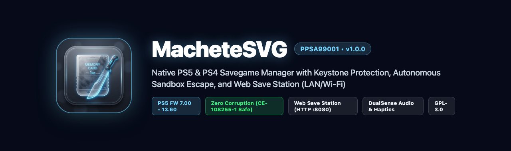
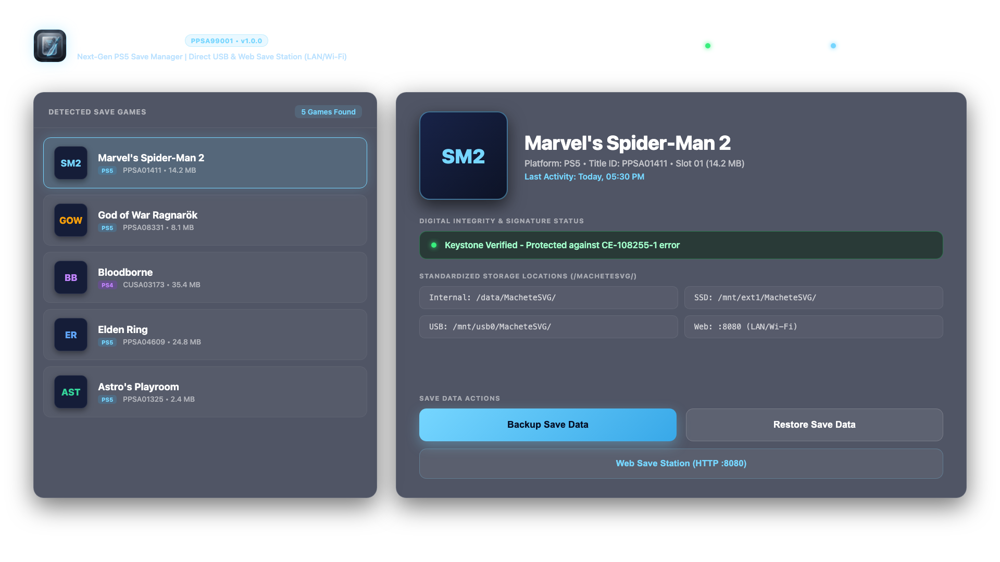
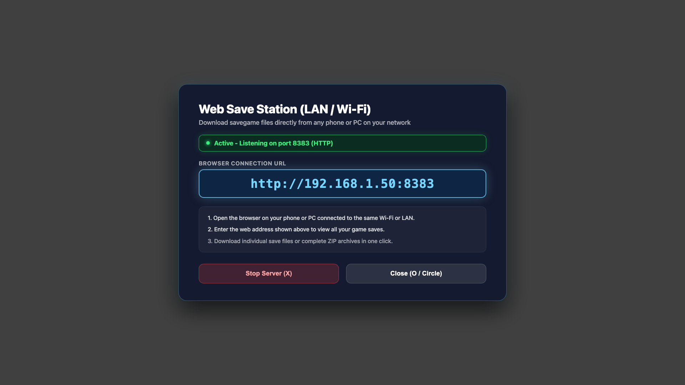

# MacheteSVG (PS5 & PS4 Savegame Manager & Web Save Station)



[](https://github.com/VenezuelanBiggie24/MacheteSVG-PS5-Save-Manager)
[](https://github.com/VenezuelanBiggie24/MacheteSVG-PS5-Save-Manager)
[](https://github.com/VenezuelanBiggie24/MacheteSVG-PS5-Save-Manager)
[](LICENSE)
[](https://github.com/VenezuelanBiggie24/MacheteSVG-PS5-Save-Manager/releases/tag/v1.2.7)

**MacheteSVG** is a native PlayStation 5 homebrew application designed to back up and restore save data (*savegames*) for both PS5 native titles and PS4 backwards-compatible games with **100% reliability**, zero risk of data corruption (preventing errors `CE-108255-1` and `CE-107109-8`), cross-console PS5 Save Dummy injection, Apollo-style PS4 auto-resigning with savedata.db corruption repair, and an embedded high-speed **Web Save Station** HTTP server (:8383) featuring an **in-app QR Code** for instant one-scan access from any smartphone, tablet, or PC on your local Wi-Fi / LAN.

---

## English Documentation

### Interface Showcase & Screenshots

The user interface is powered by a custom hardware-accelerated OpenGL 4.6 SDF renderer that delivers a fluid 60 FPS "Liquid Glass" translucent design with dual-panel layout, real-time box art rendering, spring kinematics, and full DualSense controller audio and haptic support.

| English Dashboard (1080p Render) | PS5 Hardware Capture (Real Console) |
| :---: | :---: |
|  |  |

| Web Save Station Dialog with QR Code | Modal Location Selector (Real Console) |
| :---: | :---: |
|  |  |

---

### Installation (Easy FTP Method)

1. Download `MacheteSVG_v1.2.7_PS5.zip` from [Releases](https://github.com/VenezuelanBiggie24/MacheteSVG-PS5-Save-Manager/releases).
2. Extract the ZIP archive on your computer to obtain the `PPSA99001` application folder.
3. Enable the FTP server on your PlayStation 5 (via OnionHEN, etaHEN, or your jailbreak payload).
4. Using an FTP client (FileZilla, WinSCP, Cyberduck, etc.), copy the entire `PPSA99001` folder directly into:
   ```
   /data/homebrew/
   ```
   The resulting path on your PS5 must be:
   ```
   /data/homebrew/PPSA99001/eboot.bin
   ```
5. Launch **MacheteSVG** directly from your homebrew launcher (Itemzflow, ProsperoStore, or system menu)!

---

### Core Architecture & Capabilities

#### 1. Zero-Corruption Save Architecture & Cross-Console Restoration
- **Cross-Console PS5 Save Dummy Injection:** Solves error `CE-107109-8` when restoring PS5 saves from another console or after a complete firmware reinstall. Uses `/dev/pfsmgr` to extract decrypted save files (`backup/decrypted/`). When restoring, it preserves the authentic local Save Dummy PFS container and safely hot-injects decrypted payload data into the mount point (`/data/save_mnt`), allowing the console kernel to seal the container with matching hardware keys.
- **Apollo-Style PS4 Auto-Resigning & Database Indexing:** Automatically patches 64-bit `ACCOUNT_ID`, `user_id`, and recalculates Sony `psid_hmac` inside `param.sfo` (both outer metadata and inner PFS container) while preserving the authentic `keystone` (96 bytes). Directly updates the system `savedata.db` to register the save and clear corruption flags (`is_broken = 0`, `fake_broken = 0`), completely eliminating "Corrupted Data" errors on PS5 backwards compatibility.
- **Keystone Cryptographic Preservation:** During save restore operations, console-specific identity files (`sce_sys/keystone` and `sce_sys/param.sfo`) are strictly preserved and never overwritten. Only the underlying save payload container (`data000.bin`) is replaced.
- **CE-108255-1 Prevention:** Unmounts save containers via clean `sceSaveDataUmount` system calls, allowing the Prospero kernel to seal and encrypt the PFS container without filesystem corruption.
- **Global vnode Flush (`sync()` / `fsync()`):** Atomic write operations followed by FreeBSD vnode cache invalidation guarantee that PS4 backwards-compatibility emulator caches reload restored save data instantly without requiring console reboots or game restarts.

#### 2. Embedded Web Save Station & In-App QR Code (:8383)
- **Local HTTP Web Server (:8383):** Integrated high-performance HTTP server running on dedicated port 8383 with automatic PS5 LAN IP detection. Runs on a dedicated background thread with 4 MB stack without blocking the 60 FPS UI.
- **In-App QR Code Generator (ISO/IEC 18004):** Built-in zero-dependency C++20 QR Code engine. Displays an instant scan-ready QR code in the Web Server modal dialog. Users simply scan the TV screen with their smartphone camera to open the Web Station without typing IP addresses.
- **Modern Dark Glassmorphism Web UI:** Responsive single-page web app (HTML5 / CSS3 / ES6) embedded directly inside the binary. Zero external CDN dependencies; 100% offline-ready.
- **Live Game Save Browser:** View installed games, real cover art, Title IDs, platform tags (PS5 / PS4), and save sizes from your phone or PC browser.
- **Instant ZIP Streaming:** Custom C++ streaming ZIP archive generator (IEEE 802.3 CRC32, Store mode) allowing one-click download of individual game saves or an entire library archive (`.zip`) with precalculated `Content-Length` for accurate browser progress bars.
- **Individual File Explorer:** Interactive modal to inspect files inside each save directory and download individual files (`param.json`, `sdimg_*`, `keystone`).
- **One-Touch Activation:** Toggle the server on/off via the top header badge or by pressing **Triangle** on your DualSense controller.

#### 3. Autonomous Sandbox Escape & Community Title ID Standard
- **Title ID `PPSA99001`:** Conforms to the community-established homebrew Title ID convention (`PPSA99xxx`, adopted by projects such as ProsperoStore `PPSA99000`) to guarantee zero conflicts with retail PlayStation Store software.
- **Embedded Lapy Daemon:** Packages `lapy_jb_daemon.elf` directly within the application package (`/app0/lapy_jb/`).
- **Local ELF Loader Auto-Launch:** Connects autonomously to `127.0.0.1:9021` to trigger root privilege escalation (`ucred` credential elevation) through `/download0/etahen_jailbreak`. No manual third-party payload senders are needed.
- **Live Jailbreak Monitor:** Dynamic status indicator displaying root authorization status with automatic background retry logic.

#### 4. Internationalization (i18n) Engine
- **English Default:** All system prompts, error codes, and fallback dialogs default to English.
- **Automatic Language Detection:** Inspects console parameters through `sceSystemServiceParamGetInt`. Spanish systems automatically start in Spanish, while English and all other languages default to English.
- **Real-Time Language Switch:** Press **L3** (Left Stick Click) at any moment to switch instantly between English and Spanish.

#### 5. Storage Hierarchy
Backups follow an organized, sanitized filesystem layout across all supported media:
- **Internal Storage:** `/data/MacheteSVG/[TitleID - Game Name]/`
- **M.2 Expansion SSD:** `/mnt/ext1/MacheteSVG/[TitleID - Game Name]/`
- **External USB Media:** `/mnt/usb0/MacheteSVG/[TitleID - Game Name]/`
- **Web Save Station:** Accessible from local browser at `http://<PS5-IP>:8383/` or via in-app QR code.

---

### Controller Navigation (DualSense)

| Button | Action |
| :--- | :--- |
| **D-Pad Up / Down** | Navigate through installed game saves |
| **Cross (X)** | Confirm selection / Open backup destination picker |
| **Square** | Open restore source picker |
| **Triangle** | Toggle Web Save Station (LAN / Wi-Fi HTTP Server with QR Code) |
| **L3 (Stick Click)** | Instant language toggle (English / Spanish) |
| **Circle** | Cancel active dialog / Return to dashboard |

---

## Documentación en Español (Spanish Documentation)

### Galería de Capturas de Pantalla

La interfaz gráfica cuenta con un renderizador SDF sobre OpenGL 4.6 acelerado por hardware que funciona a 60 FPS fluidos con diseño translúcido "Liquid Glass", vista dividida, carátulas en tiempo real, física de resortes y respuesta sonora completa de DualSense.

| Panel Principal en Inglés (Render 1080p) | Captura de Hardware Real en PS5 |
| :---: | :---: |
|  |  |

| Diálogo de Estación Web con Código QR | Selector Modal de Ubicación (Consola Real) |
| :---: | :---: |
|  |  |

---

### Instalación (Método Fácil vía FTP)

1. Descarga `MacheteSVG_v1.2.7_PS5.zip` desde la sección [Releases](https://github.com/VenezuelanBiggie24/MacheteSVG-PS5-Save-Manager/releases).
2. Extrae el archivo ZIP en tu computadora para obtener la carpeta `PPSA99001`.
3. Habilita el servidor FTP en tu PlayStation 5 (a través de OnionHEN, etaHEN o tu payload jailbreak).
4. Usando un cliente FTP (FileZilla, WinSCP, Cyberduck, etc.), copia la carpeta `PPSA99001` completa directamente en:
   ```
   /data/homebrew/
   ```
   La ruta resultante en tu PS5 debe ser:
   ```
   /data/homebrew/PPSA99001/eboot.bin
   ```
5. Inicia **MacheteSVG** directamente desde tu lanzador de homebrew (Itemzflow, ProsperoStore o menú principal).

---

### Arquitectura y Capacidades Principales

#### 1. Arquitectura con Cero Corrupción y Restauración Cross-Console
- **Inyección Cross-Console de Partidas PS5 con Save Dummy:** Soluciona el error `CE-107109-8` al restaurar partidas de PS5 provenientes de otra consola o tras formatear el sistema. Utiliza `/dev/pfsmgr` para extraer los archivos desencriptados (`backup/decrypted/`). Al restaurar, preserva el contenedor Save Dummy local auténtico e inyecta en caliente los datos desencriptados en el punto de montaje (`/data/save_mnt`), permitiendo que el kernel de Prospero selle el contenedor con las claves maestras locales de la consola.
- **Resignado Automático Estilo Apollo e Indexación en Base de Datos para PS4:** Modifica automáticamente el `ACCOUNT_ID` de 64 bits, actualiza el `user_id` y recalcula el `psid_hmac` de Sony en `param.sfo` (tanto externo como dentro de la imagen PFS), preservando el `keystone` original (96 bytes). Actualiza directamente la base de datos `savedata.db` del sistema eliminando las banderas de corrupción (`is_broken = 0`, `fake_broken = 0`) para que los juegos de PS4 en retrocompatibilidad reconozcan la partida de inmediato sin errores de "Datos dañados".
- **Preservación Criptográfica de Keystone:** Durante las operaciones de restauración, los archivos de identidad de la consola (`sce_sys/keystone` y `sce_sys/param.sfo`) se mantienen intactos y nunca se sobrescriben. Solo se actualiza el contenedor de datos (`data000.bin`).
- **Prevención del Error CE-108255-1:** Desmontaje limpio mediante llamadas `sceSaveDataUmount`, asegurando que el kernel de Prospero selle y cifre los contenedores PFS adecuadamente.
- **Vaciado Global de Caché vnode (`sync()` / `fsync()`):** Operaciones atómicas que invalidan las tablas de caché del emulador de PS4, permitiendo que las partidas restauradas se reflejen al instante sin reiniciar la consola.

#### 2. Estación Web Local Integrada con Código QR (:8383)
- **Servidor Web HTTP Local (:8383):** Servidor HTTP de alto rendimiento embebido en el puerto 8383 con detección automática de la IP local de la consola PS5. Corre en un hilo de fondo dedicado con 4 MB de pila sin afectar los 60 FPS de la interfaz.
- **Generador de Código QR en Pantalla (ISO/IEC 18004):** Motor QR nativo en C++20 sin dependencias externas. Renderiza un código QR limpio y escaneable en el diálogo del Servidor Web. El usuario simplemente apunta la cámara de su teléfono o tablet hacia la pantalla del televisor para entrar de inmediato a la Estación Web sin escribir IPs.
- **Interfaz Web Dark Glassmorphism:** Aplicación web moderna (HTML5 / CSS3 / ES6) integrada directamente en el binario sin enlaces a CDNs externos ni requerir conexión a Internet.
- **Explorador de Partidas en Vivo:** Visualiza tus títulos instalados, carátulas auténticas, Title IDs, plataformas (PS5 / PS4) y peso de datos de guardado desde cualquier navegador en PC o teléfono inteligente.
- **Transmisión de Archivos ZIP al Vuelo:** Generador streaming de archivos ZIP en C++ (IEEE 802.3 CRC32, modo Store) que permite descargar partidas individuales o la librería completa en un archivo `.zip` con barra de progreso real en el navegador gracias al cálculo anticipado de `Content-Length`.
- **Explorador de Archivos Individuales:** Modal interactivo en el navegador para explorar el contenido interno de cada partida y descargar archivos sueltos (`param.json`, `sdimg_*`, `keystone`).
- **Activación Rápida:** Enciende o apaga el servidor con un solo toque desde la cabecera superior o pulsando el botón **Triángulo** en el mando DualSense.

#### 3. Escape Autónomo del Sandbox y Convención de Title ID
- **Title ID `PPSA99001`:** Cumple con la nomenclatura comunitaria de homebrew (`PPSA99xxx`) para prevenir conflictos con títulos oficiales de PlayStation Store.
- **Demonio Lapy Incluido:** Integra `lapy_jb_daemon.elf` dentro de `/app0/lapy_jb/`.
- **Lanzamiento Automático:** Se conecta al cargador ELF local (`127.0.0.1:9021`) y solicita la elevación de privilegios root (`ucred`) a través de `/download0/etahen_jailbreak`. No se necesitan aplicaciones de inyección adicionales.
- **Monitor de Jailbreak:** Indicador dinámico de estado root con reintento automático en segundo plano.

#### 4. Motor de Internacionalización (i18n)
- **Inglés Predeterminado:** Todas las pantallas y mensajes de error inician por defecto en inglés para consolas de cualquier región internacional.
- **Detección Automática:** Verifica la configuración de la consola con `sceSystemServiceParamGetInt`. Si la consola está en español, inicia automáticamente en español.
- **Cambio en Vivo:** Pulsa **L3** en cualquier momento para alternar al instante entre inglés y español.

#### 5. Jerarquía de Almacenamiento
Estructura ordenada y compatible con sistemas de archivos FAT32/exFAT:
- **Almacenamiento Interno:** `/data/MacheteSVG/[TitleID - Nombre del Juego]/`
- **SSD de Expansión M.2:** `/mnt/ext1/MacheteSVG/[TitleID - Nombre del Juego]/`
- **Unidades USB:** `/mnt/usb0/MacheteSVG/[TitleID - Nombre del Juego]/`
- **Estación Web:** Accesible desde el navegador en `http://<IP-PS5>:8383/` o mediante el código QR en pantalla.

---

### Controles del Mando DualSense

| Botón | Acción |
| :--- | :--- |
| **D-Pad Arriba / Abajo** | Navegar entre las partidas guardadas |
| **Cruz (X)** | Confirmar selección / Elegir destino de respaldo |
| **Cuadrado** | Elegir origen de restauración |
| **Triángulo** | Activar Estación Web Local con Código QR (Servidor HTTP LAN/Wi-Fi) |
| **L3 (Click Stick)** | Alternar idioma al instante (Inglés / Español) |
| **Círculo** | Cancelar diálogo activo / Volver al menú |

---

## Source Code Structure / Estructura del Código

```
MacheteSVG/
├── docs/
│   └── screenshots/       # Visual assets, banners, and real hardware captures
├── sce_sys/
│   ├── icon0.png          # High-resolution 512x512 Liquid Glass icon
│   ├── param.json         # PS5 application manifest (Title ID: PPSA99001)
│   └── snd0.at9           # System background audio
├── src/
│   ├── app/               # Main application loop, shell, and context
│   ├── concepts/          # Liquid Glass UI screens & registry
│   ├── core/              # Save manager, i18n, storage, and jailbreak daemon launcher
│   ├── gfx/               # Hardware-accelerated OpenGL 4.6 SDF renderer
│   ├── server/            # Embedded HTTP web server, UI, and streaming ZIP writer
│   └── ui/                # Theme, widgets, and DualSense glyphs
├── tools/
│   ├── package.sh         # Packaging script enforcing 0777 open-mode permissions
│   └── zip-open-modes.py  # ZIP permissions validator
├── tests/                 # GoogleTest unit test suites
├── CHANGELOG.md           # Version history and milestone documentation
├── CONTRIBUTING.md        # Contribution guidelines (Bilingual)
├── CREDITS.md             # Attribution to scene pioneers
├── LICENSE                # GNU General Public License v3.0
├── Makefile               # Cross-compilation and testing rules
└── RELEASE_NOTES.md       # v1.0.0 release notes
```

---

## Compiling & Testing / Compilación y Pruebas

### Running Unit Tests (GoogleTest)
```bash
PATH="/opt/homebrew/bin:/opt/homebrew/opt/coreutils/libexec/gnubin:$PATH" make test-unit
```

### Building & Packaging for PS5
```bash
PATH="/opt/homebrew/bin:/opt/homebrew/opt/coreutils/libexec/gnubin:/opt/homebrew/opt/llvm/bin:$PATH" \
PS5_CLANG=/opt/homebrew/opt/llvm/bin/clang \
HOST_CXX=/opt/homebrew/opt/llvm/bin/clang++ \
CXX=/opt/homebrew/opt/llvm/bin/clang++ \
make app && bash tools/package.sh
```

---

## Credits & License

MacheteSVG is released under the **GNU General Public License v3.0 (GPL-3.0)**. See [LICENSE](LICENSE) for details.
We thank the PlayStation homebrew community and pioneer projects: **Apollo Save Tool** (Bucanero), **PS5-Lapy-JB-Daemon** (ArkSama & Lapy), **ProsperoStore** (BlackBearReloaded), **ShadowMountPlus** (Drakmor & VoidWhisper), **kstuff-lite** (EchoStretch & sleirsgoevy), **KSystemLib**, **ps5-payload-sdk** (John Törnblom), and the **etaHEN** team. Full attributions are listed in [CREDITS.md](CREDITS.md).
